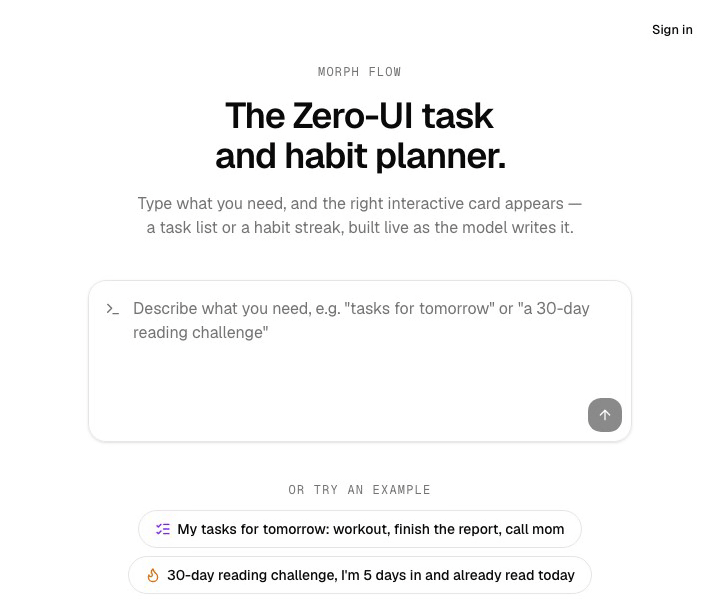
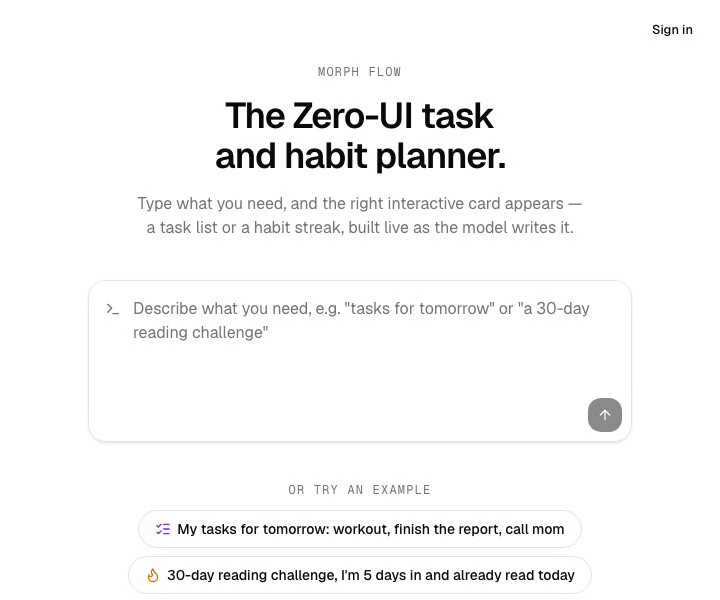
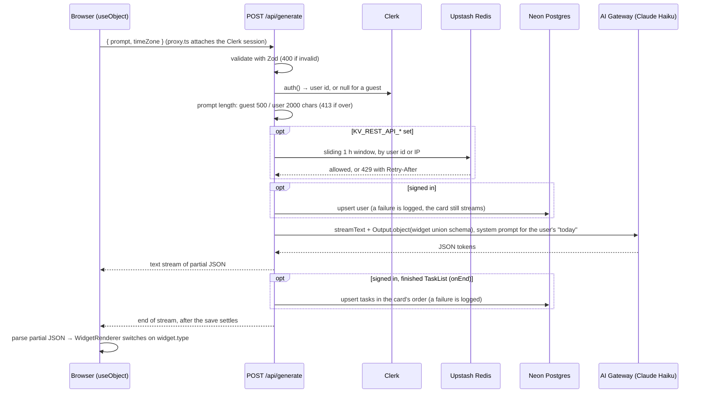
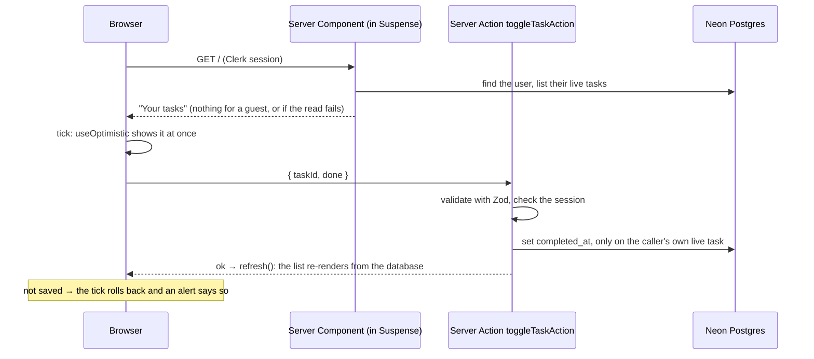

# Morph Flow

**The Zero-UI task and habit planner.** Type what you need in plain words, and the right
interactive card appears: a task list or a habit streak. The model picks the widget, and the card
fills in live while the model is still writing it.

**Live demo:** [morph-flow-ten.vercel.app](https://morph-flow-ten.vercel.app/)



> **🚧 Status: work in progress.**
>
> **Works now:** a TaskList or HabitStreakCard from one prompt, streaming in live; optional
> sign-in with Clerk; hourly generation limits for guests and signed-in users; a signed-in
> user's generated tasks are saved to Postgres and listed on the start screen, where they can
> be ticked off.
>
> **Next:** editing and deleting saved tasks, saving habits, keeping a guest's cards in the
> browser, then more widget types. Before a wider launch: a Clerk production instance on our own
> domain (the demo runs on development keys) and the database migrations in production.

## Widgets

The model picks one of these from the prompt:

- **TaskList:** _"My tasks for tomorrow: workout, finish the report, call mom"_ → tasks with due
  dates and priorities, streamed in row by row. Signed in, the tasks are saved and show up under
  **Your tasks** on the start screen.
- **HabitStreakCard:** _"Drink 2 liters of water every day for a month"_ → a streak toward a goal,
  with a check-in button that works as soon as the card is complete.



## How it works

One request produces one widget. The client streams partial JSON and renders whatever is there
so far: a skeleton until the widget `type` is complete, then the matching component, growing as
fields arrive.



- **One schema, two jobs.** Each widget is a Zod schema. The schemas are combined into a
  discriminated union on `type`, which the model receives as JSON Schema (structured output) and
  the client uses to parse the stream.
- **The registry drives the prompt.** Every widget has a definition (`whenToUse`, `rules`,
  `examplePrompt`). The system prompt, the union schema and the example presets are all built
  from the `WIDGETS` list.
- **Dates in the user's day.** The browser sends its time zone, so "tomorrow" resolves to the
  user's calendar date, not the server's.
- **Limits before cost.** Rejected requests (400, 413) don't use up the hourly allowance. If
  Redis is down, the request goes through and the prompt limit still caps its cost.
- **Errors stay on the server.** The client shows a generic message. Details go to the server log.

### Saved tasks

A signed-in user's start screen lists their saved tasks under the examples. Ticking one off
shows at once and is saved in the background:



- **Most urgent first.** The card shows the open tasks with the nearest due date, then the
  highest priority: 5 of them, or 3 on a phone (by CSS, so there is no hydration mismatch).
  **Show all** lists every task, done ones last.
- **Rows don't jump.** Each view keeps its rows from when it opened, so a ticked task stays in
  place, struck through, until the next visit.
- **New cards land there too.** When a card finishes streaming, the client refreshes the Server
  Components. The server saved the tasks before the stream ended, so after **New** they are in
  the list with their database ids. The streamed card itself stays read-only.

## Stack

Next.js 16 (App Router) · React 19 · TypeScript (strict) · AI SDK 7 with Vercel AI Gateway ·
Zod 4 · Clerk (auth) · Neon Postgres + Drizzle ORM · Upstash Redis + Ratelimit · Tailwind CSS 4 ·
shadcn/ui · Vitest + React Testing Library · Playwright · pnpm

## Getting started

Requirements: **Node.js 22+** and **pnpm** (the version is pinned in `package.json`; `corepack enable` picks it up).

```bash
pnpm install
cp .env.example .env.local
```

Only the model credentials are required. Everything else can stay empty for a first look:

| Variable                                                | Needed                           | Without it                                                           |
| ------------------------------------------------------- | -------------------------------- | -------------------------------------------------------------------- |
| `AI_GATEWAY_API_KEY`                                    | **Yes** (or a Vercel OIDC token) | Generation fails.                                                    |
| `NEXT_PUBLIC_CLERK_PUBLISHABLE_KEY`, `CLERK_SECRET_KEY` | For `build` / `start` / e2e      | `pnpm dev` runs Clerk in keyless mode with a temporary dev instance. |
| `DATABASE_URL`                                          | To save signed-in users' cards   | Cards still generate; saving fails and is logged.                    |
| `KV_REST_API_URL`, `KV_REST_API_TOKEN`                  | No                               | The rate limit turns itself off and the server logs a warning.       |
| `E2E_CLERK_USER_EMAIL`                                  | No                               | e2e signs in as `e2e+clerk_test@example.com`, created on first run.  |

- **Model:** the app calls the model through [Vercel AI Gateway](https://vercel.com/docs/ai-gateway).
  Create an AI Gateway API key, or link the repo to a Vercel project (`vercel link`, then
  `vercel env pull .env.local`) to get a short-lived OIDC token instead.
- **Database:** create a [Neon](https://neon.tech) database (the Vercel Marketplace integration
  works too), set `DATABASE_URL`, then apply the migrations with `pnpm db:migrate`.
- **Rate limit:** the Upstash for Redis integration on Vercel sets the `KV_REST_API_*` names.
  Guests get 10 generations per hour (by IP), signed-in users 30 (by account).

Then start the dev server and open [http://localhost:3000](http://localhost:3000):

```bash
pnpm dev
```

## Scripts

| Command             | What it does                     |
| ------------------- | -------------------------------- |
| `pnpm dev`          | Dev server with Turbopack        |
| `pnpm build`        | Production build                 |
| `pnpm start`        | Serve the production build       |
| `pnpm test`         | Unit and component tests once    |
| `pnpm test:db`      | SQL tests on the Neon dev branch |
| `pnpm test:watch`   | Tests in watch mode              |
| `pnpm test:e2e`     | Playwright end-to-end tests      |
| `pnpm typecheck`    | `next typegen` + `tsc --noEmit`  |
| `pnpm lint`         | ESLint                           |
| `pnpm format:check` | Prettier check (`format` fixes)  |
| `pnpm db:generate`  | Drizzle migration from schema    |
| `pnpm db:migrate`   | Apply migrations to the DB       |
| `pnpm db:studio`    | Drizzle Studio                   |

## Project structure

```
src/
  core/        Platform-agnostic logic: widget schemas, definitions, view models, date helpers.
               No React, Next.js, DOM or Node imports (enforced by ESLint), so it can become
               a shared package for a React Native app later.
  server/      The generate handler and the streaming call to the model.
    tasks/     Loading saved tasks and toggling one, with Clerk and the database injected.
    db/        Drizzle schema, Neon client, users and tasks repositories. Migrations live
               in /drizzle.
    rateLimit/ Upstash sliding-window limiter, keyed by Clerk user id or client IP.
  proxy.ts     Clerk middleware: attaches the session, keeps every route public.
  app/         Next.js routes: the page and /api/generate. actions/ holds the Server Actions,
               _tasks/ the "Your tasks" Server Component and its Clerk/Neon wiring.
  hooks/       useWidgetStream (useObject wrapper), useGeneratorSession (field, stream,
               start screen ↔ canvas), and the saved list's optimistic tick and expansion.
  components/
    generator/ Prompt field, example presets, and WidgetRenderer.
    savedTasks/ The "Your tasks" card: rows, Show all, the save-failed alert.
    widgets/   One folder per widget, plus shared accents and the header icon tile.
    landing/   The hero on the start screen.
    ui/        shadcn/ui primitives.
```

## Adding a widget

1. **Schema:** `src/core/widgets/<name>.schema.ts`, a Zod object with a `type` literal. Put field
   formats in `.describe()`, since they reach the model as JSON Schema.
2. **Definition:** `src/core/widgets/<name>.widget.ts` with `whenToUse`, `rules` and an
   `examplePrompt`, then add it to `WIDGETS` in `widget.schema.ts`. The prompt, the union and
   the presets pick it up from there.
3. **Component:** `src/components/widgets/<name>/`. It must render a _partial_ widget, because
   fields arrive one by one. A pure view function in `core` that fills in defaults keeps this
   simple (see `habitStreakCard.view.ts`).
4. **Wire it up.** The build fails until you add a `case` in `WidgetRenderer` and an icon and
   color in `widgetAccents.ts`.

## Testing

Tests sit next to the code (`foo.ts` → `foo.test.ts`) and use `@faker-js/faker` factories from
`src/core/test/factories`. The handler is tested with a mock language model
(`src/server/test/mockLanguageModel.ts`), and the generator UI with a fetch stub that streams the
response chunk by chunk. No test calls the real model.

`pnpm test` runs Vitest and needs no network. `pnpm test:db` runs the repository tests
(`*.db.test.ts`) against real Postgres: it takes `DATABASE_URL` from `.env.development.local`
only, so it can never reach production, and every test deletes the users it created.

`pnpm test:e2e` runs Playwright (`e2e/`) against a fresh production build on port 3100. It points
the browser at a local mock that streams the response chunk by chunk, so it checks the card
building up, finishing, and being dropped by **New** without calling the model. The first run
needs a browser: `pnpm exec playwright install chromium`.

The saved-tasks specs sign in for real with `@clerk/testing`: a test user (see
`E2E_CLERK_USER_EMAIL`) is created once in the Clerk dev instance and signed in with a
server-side token. They need the Clerk keys and `.env.development.local`: the run takes
`DATABASE_URL` from there only, for the tests and for the app under test, so it can only reach
the Neon dev branch. Clerk Protect requests are blocked in the tests, since its probes never let
the page go idle.
