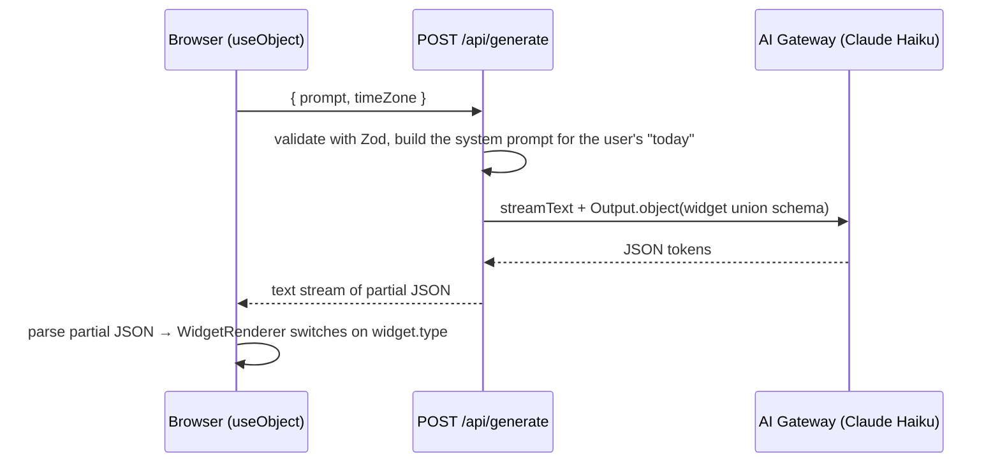

# Morph Flow

**The Zero-UI task and habit planner.** Type what you need in plain words, and the right
interactive card appears: a task list or a habit streak. The model picks the widget, and the card
fills in live while the model is still writing it.

- _"My tasks for tomorrow: workout, finish the report, call mom"_ → a **TaskList** with due dates and priorities
- _"30-day reading challenge, I'm 5 days in and already read today"_ → a **HabitStreakCard** with progress and a check-in button

## How it works

One request produces one widget. The client streams partial JSON and renders whatever is there
so far: a skeleton until the widget `type` is complete, then the matching component, growing as
fields arrive.



- **One schema, two jobs.** Each widget is a Zod schema. The schemas are combined into a
  discriminated union on `type`, which the model receives as JSON Schema (structured output) and
  the client uses to parse the stream.
- **The registry drives the prompt.** Every widget has a definition (`whenToUse`, `rules`,
  `examplePrompt`). The system prompt, the union schema and the example presets are all built
  from the `WIDGETS` list.
- **Dates in the user's day.** The browser sends its time zone, so "tomorrow" resolves to the
  user's calendar date, not the server's.
- **Errors stay on the server.** The client shows a generic message. Details go to the server log.

## Stack

Next.js 16 (App Router) · React 19 · TypeScript (strict) · AI SDK 7 with Vercel AI Gateway ·
Zod 4 · Tailwind CSS 4 · shadcn/ui · Vitest + React Testing Library · pnpm

## Getting started

Requirements: **Node.js 22+** and **pnpm** (the version is pinned in `package.json`; `corepack enable` picks it up).

```bash
pnpm install
```

The app calls the model through [Vercel AI Gateway](https://vercel.com/docs/ai-gateway). Give it
credentials in one of two ways:

- **API key:** create an AI Gateway API key and put it in `.env.local`:

  ```bash
  AI_GATEWAY_API_KEY=your_key_here
  ```

- **Vercel project:** if the repo is linked to a Vercel project, `vercel link` then
  `vercel env pull` writes a short-lived OIDC token to `.env.local` instead.

Then start the dev server and open [http://localhost:3000](http://localhost:3000):

```bash
pnpm dev
```

## Scripts

| Command             | What it does                    |
| ------------------- | ------------------------------- |
| `pnpm dev`          | Dev server with Turbopack       |
| `pnpm build`        | Production build                |
| `pnpm start`        | Serve the production build      |
| `pnpm test`         | Run all tests once (Vitest)     |
| `pnpm test:watch`   | Tests in watch mode             |
| `pnpm typecheck`    | `tsc --noEmit`                  |
| `pnpm lint`         | ESLint                          |
| `pnpm format:check` | Prettier check (`format` fixes) |

## Project structure

```
src/
  core/        Platform-agnostic logic: widget schemas, definitions, view models, date helpers.
               No React, Next.js, DOM or Node imports (enforced by ESLint), so it can become
               a shared package for a React Native app later.
  server/      The generate handler and the streaming call to the model.
  app/         Next.js routes: the page and /api/generate.
  hooks/       useWidgetStream (useObject wrapper) and useGeneratorSession (field, stream,
               start screen ↔ canvas).
  components/
    generator/ Prompt field, example presets, and WidgetRenderer.
    widgets/   One folder per widget, plus shared accents and the header icon tile.
    landing/   The hero on the start screen.
    ui/        shadcn/ui primitives.
```

## Adding a widget

1. **Schema:** `src/core/widgets/<name>.schema.ts`, a Zod object with a `type` literal. Put field
   formats in `.describe()`, since they reach the model as JSON Schema.
2. **Definition:** `src/core/widgets/<name>.widget.ts` with `whenToUse`, `rules` and an
   `examplePrompt`, then add it to `WIDGETS` in `widget.schema.ts`. The prompt, the union and
   the presets pick it up from there.
3. **Component:** `src/components/widgets/<name>/`. It must render a _partial_ widget, because
   fields arrive one by one. A pure view function in `core` that fills in defaults keeps this
   simple (see `habitStreakCard.view.ts`).
4. **Wire it up.** The build fails until you add a `case` in `WidgetRenderer` and an icon and
   color in `widgetAccents.ts`.

## Testing

Tests sit next to the code (`foo.ts` → `foo.test.ts`) and use `@faker-js/faker` factories from
`src/core/test/factories`. The handler is tested with a mock language model
(`src/server/test/mockLanguageModel.ts`), and the generator UI with a fetch stub that streams the
response chunk by chunk. No test calls the real model.

`pnpm test` runs Vitest. `pnpm test:e2e` runs Playwright (`e2e/`) against a production build on
port 3100. It points the browser at a local mock that streams the response chunk by chunk, so it
checks the card building up, finishing, and being dropped by **New** without calling the model.
The first run needs a browser: `pnpm exec playwright install chromium`.
